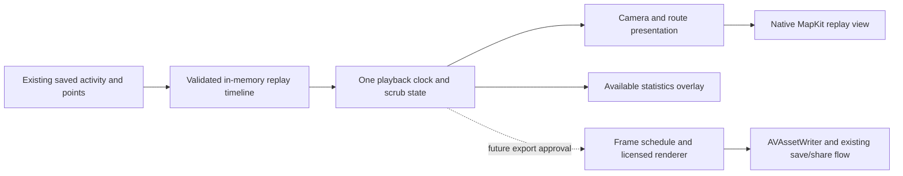

# MURY — 3D replay and cinematic flyover feasibility
Date: 31 October 2026  
Status: PROPOSAL ONLY. No feature implementation, prototype, provider signup, paid service, build, commit, push or release authorized by this document.

## Recommendation
Evaluate an additive, on-device MapKit replay first. Keep the existing recorder, data models and sharing path intact. Treat cinematic MP4 generation as a separate, gated workstream. This is a candidate architecture, not evidence that MapKit meets the reference imagery.

The owner requested realistic urban flythroughs. A tilted flat map is not sufficient acceptance. If MapKit cannot show convincing buildings and terrain on representative routes, record that failure and return a provider decision; do not quietly lower the requirement. Mapbox is a credible alternative for controlled styling and camera motion. Google Photorealistic 3D Tiles with a suitable renderer offers a separate photorealistic direction, but routine user-video rights have not been established.

The supplied attachment actually ends after “Native iOS 3D buildings and”. This assessment covers all visible requirements and independently selected alternatives; it cannot claim to cover missing sections.

## Verified repository baseline
Read-only git status showed a clean working tree on feature/mury-branding tracking origin/feature/mury-branding before this report. Existing implementation baseline is the previously committed MURY branding work. No runtime verification was performed during this investigation.

Inspected source:
- [larping/Features/Activities/ActivityDetailView.swift](/C:/Users/Ricardo%20Bueno/PROJECTS/MURY%20-%20LARPING/larping/Features/Activities/ActivityDetailView.swift): standard Map, route reveal over 5.5 seconds, approximately 12 updates/second, sport marker; gestures disabled. This is a point-count animation, not timestamp playback or a camera flight.
- [larping/Core/ShareImageComposer.swift](/C:/Users/Ricardo%20Bueno/PROJECTS/MURY%20-%20LARPING/larping/Core/ShareImageComposer.swift): one standard MapKit snapshot, showsBuildings=false, 1080×1920 image composition, selected Pink/Tiffany style.
- [larping/Core/ShareVideoComposer.swift](/C:/Users/Ricardo%20Bueno/PROJECTS/MURY%20-%20LARPING/larping/Core/ShareVideoComposer.swift): AVAssetWriter, H.264, 6 seconds at 60 fps; route reveal drawn over that same snapshot. No moving 3D renderer.
- [larping/Core/Models/CDTrackPoint.swift](/C:/Users/Ricardo%20Bueno/PROJECTS/MURY%20-%20LARPING/larping/Core/Models/CDTrackPoint.swift): timestamp, coordinates, optional altitude, speed, heart rate and cadence.
- [larping/Core/Models/CDActivity.swift](/C:/Users/Ricardo%20Bueno/PROJECTS/MURY%20-%20LARPING/larping/Core/Models/CDActivity.swift): start/end, aggregate duration/distance/elevation/speed, related points; no pause-event list.
- [larping/Core/Location/LocationTracker.swift](/C:/Users/Ricardo%20Bueno/PROJECTS/MURY%20-%20LARPING/larping/Core/Location/LocationTracker.swift): pause stops location updates, duration excludes manual pauses; valid altitude/speed samples stored, without persisted accuracy fields.

Existing AVAssetWriter/error cleanup and file sharing can be reused conceptually. Existing static formatted statistics and point-count reveal must not become the new replay timeline.

## Product boundaries
Proposed journey: Activity details → Replay → loading map → paused route overview → Play → pause/scrub/change speed or camera → optional export preview → explicit generate → native sharing or save.

Offer Follow, Aerial, Top-Down and Free View. Free View releases camera following but leaves the timeline and marker running; a Return to Follow control restores it. Pause freezes activity time; gestures remain available. Leaving the screen cancels replay work. On backgrounding, pause replay and expensive rendering; this is separate from live GPS recording, which must continue to work unchanged.

Use the recorded elapsed timeline for 1×, 2× and 4×. Scrubbing updates marker, route and available statistics from the same time. A separate future highlight export could compress a long activity into a short clip; do not label that compression “1×”. Duration and captions must distinguish activity time from video time.

No accounts, feed, followers, clubs, route discovery, backend rendering, music licensing or automatic Instagram publishing are included. Those appear in reference art but were not authorized requirements. Preserve existing Pink/Tiffany identity. Blood-red route #B20E1C and the blue/red logo are proposed styling only and require a branding decision before adoption. No original vector master for that new identity was supplied.

## Provider comparison
| Candidate | What is supported or plausible | Main limits | Recommendation |
|---|---|---|---|
| Apple MapKit | Native camera, route overlays, realistic terrain and satellite/flyover styles; existing platform integration | Coverage and visual result vary; camera zoom constraints; no verified collision-avoidance or deterministic video path in this investigation | First interactive feasibility candidate |
| Mapbox Maps SDK for iOS | Terrain, map styling and independently animated camera properties; building detail depends on style/data | New dependency/token/provider, attribution and telemetry obligations; not automatically photorealistic street-level imagery; video rights require applicable terms | Alternative if MapKit visual/control trial fails |
| Google Photorealistic 3D Tiles + renderer | Textured urban mesh candidate, custom route overlay | Renderer integration, coverage/streaming/memory/cost; published video exception is narrowly promotional | Do not select for user exports without rights clearance |
| Cesium Native as renderer infrastructure | 3D Tiles streaming/integration foundation | Integration needs renderer resources; not a ready SwiftUI map replacement or independent source of imagery rights | Larger alternative only if photorealism outweighs native simplicity |

Apple demonstrates realistic elevation and flyover/satellite styles in [Meet MapKit for SwiftUI](https://developer.apple.com/videos/play/wwdc2023/10043/). Its [camera distance API](https://developer.apple.com/documentation/mapkit/mkmapcamera/centercoordinatedistance) measures camera-to-map-center distance, not a guaranteed height above the road. [Apple’s camera guidance](https://developer.apple.com/videos/play/wwdc2019/236/) explains that map zoom limits cannot be overridden by requesting a smaller range.

Mapbox documents [camera animations](https://docs.mapbox.com/ios/maps/guides/camera-and-animation/animations/) and [SDK conditions](https://docs.mapbox.com/ios/maps/guides/), including attribution and a telemetry opt-out. [Cesium’s integration documentation](https://cesium.com/learn/cesium-native/ref-doc/rendering-3d-tiles.html) describes renderer resources supplied by the integrating application.

## Why 10–30 metres cannot be promised yet
A GPS altitude sample is not the height of the road surface or a building collision model. Bridges, tunnels, tall buildings, slopes and inaccurate points complicate a low camera. Camera-to-center distance is also not interchangeable with height above street level.

Propose a higher oblique Aerial default, with lower Follow only where the trial demonstrates usable imagery. Smooth heading across north/360° and short noisy segments, use look-ahead framing, and ease turns without changing the recorded route. Never snap the original activity onto a road. An elevated fallback is a visibility strategy, not verified collision avoidance. Guaranteed collision-aware flights would need a proven geometry/collision source and additional engineering.

Pass condition for the trial: document actual camera settings, clipping/occlusion and imagery quality on city-centre, residential, bridge/tunnel and hilly routes. Include London plus at least one city from the references; no claim of worldwide coverage.

## Timeline and statistics contract
Build an immutable, in-memory replay representation from existing saved points. Do not write back or change the persistence schema.
- Validate coordinates and finite values; sort by timestamp with a stable tie-breaker. Duplicate timestamps cannot form a speed denominator.
- Interpolate position only across plausible short continuous segments. Large time/spatial gaps show a discontinuity rather than a fictional straight flight through buildings.
- Use one activity time for marker, route reveal, camera target and statistics. Scrub results must not depend on prior playback.
- Use saved activity totals as authoritative final summary. Any cumulative replay distance recomputed from samples is explicitly a replay estimate and may not equal recorder totals.
- Elapsed time can use saved start/end and timestamps. Saved active duration is available as a final total for mobile recordings, but exact per-segment moving time and manual pauses cannot be reconstructed reliably from gaps alone.
- During legacy replay, show elapsed time and final active-duration summary; omit unavailable time-varying moving time. Do not present a gap heuristic as recorded pause history.
- Current speed is shown only with valid samples or a clearly identified, validated estimate. Pace at rest is unavailable, not infinity. Missing altitude means no current elevation/profile for that segment.
- Do not recompute authoritative elevation gain from noisy points. A replay profile represents recorded sample altitude, not surveyed terrain or camera height.

If exact historic moving-time overlays are mandatory, that requirement remains blocked by missing data. Future pause-event storage would require a separate approved schema/migration decision; it cannot repair old activities.

## Minimal proposed architecture

Do not add a provider abstraction before a second provider is selected. Keep timeline computation independent of the UI for tests; keep map-specific camera work beside the replay view.

Potential future file scope, not files created in this phase:
| File/component | Purpose |
|---|---|
| Features/Activities/ActivityDetailView.swift | Add Replay entry; retain current map/share |
| Features/Activities/ActivityReplayView.swift (new) | Map, controls, loading/error/recovery and accessibility |
| Features/Activities/ReplayTimeline.swift (new) | Pure point validation, time sampling and available metrics |
| larpingTests/ReplayTimelineTests.swift (new) | Irregular timestamps, gaps, duplicates, missing metrics, scrubbing |
| larpingUITests/ReplayTests.swift (new) | Playback controls, error fallback, exit/background behavior |
| Core/ShareVideoComposer.swift and ShareImageComposer.swift | Later export phase only; preserve current templates |
| Features/Activities/ShareActivityView.swift | Later format/export integration |
| Core/ShareExportDocument.swift | Reuse existing export boundary; alter only if format work requires it |
| larping.xcodeproj/project.pbxproj | Include files only if project membership requires; no signing/workflow changes |

Recorder, HealthKit, stored models, permissions, backups and release workflows are out of scope.

## Export feasibility and licensing gate
AVAssetWriter can encode frames; it does not obtain a complete 3D scene. A working interactive map does not prove reliable frame capture, tile readiness or legal permission to distribute imagery.

A future experiment must first establish a supported frame source with consistent camera/tiles/overlays. Do not assume a UIView screenshot captures GPU map content reliably, or that one snapshot request per output frame is acceptable. ReplayKit is a user-facing recording alternative, not proof of deterministic, faster-than-real-time export. Do not build any of these in this phase.

Proposed initial export target after rights/technical approval: H.264 MP4 at 30 fps, 1080×1920, 1920×1080 and 1080×1080. Reflow branding, stats, attribution and captions for each canvas; do not crop an already branded portrait frame. Offer a preview, progress, cancel, storage failure/retry and clean temporary-file handling. Save-to-Files/native sharing can reuse the existing flow. Saving directly to Photos is separate permission work requiring approval.

Keep map attribution visible in every frame and after social cropping. No direct Instagram posting claim: hand the completed file to supported iOS sharing destinations.

Rights assessment, not a legal clearance:
- [Apple’s current agreement, Attachment 6](https://developer.apple.com/support/terms/apple-developer-program-license-agreement/) restricts copying, storage and map-data reuse and requires attribution. Routine 3D social-video distribution was not established as permitted by this investigation. Confirm the applicable accepted agreement and permission for the exact workflow before shipping. Existing map-image/video exports were not legally cleared by this source audit either.
- [Google Map Tiles policies](https://developers.google.com/maps/documentation/tile/policies) describe promotional videos of at most 30 seconds, about app capabilities, marked for promotional purposes, with attribution and other restrictions. This does not establish a right to provide arbitrary personal route-video exports. Obtain a suitable written entitlement before relying on that content.
- [Mapbox pricing](https://www.mapbox.com/pricing) distinguishes commercial print/video rights from SDK use and points to [Product Terms](https://www.mapbox.com/legal/product-terms). No applicable account-specific video entitlement was verified.
- Renderer open-source licensing does not grant rights to its imagery, buildings or terrain.

## Privacy, performance and cost
Replay should need no new live-location or HealthKit permission. Read the selected activity locally and do not send the complete GPX/HealthKit payload to a new backend. Map views still request regional content from providers; disclose that boundary. A third-party SDK needs its own privacy/telemetry review. Proposed exports should preview precise start/end locations and allow deliberate hiding of sensitive endpoints without altering the saved activity.

Stream and release frames rather than retaining the whole movie in memory. Measure tile loading, GPU load, memory, thermal behavior, file size and cancellation on a real iPhone. Under memory pressure or missing imagery, offer a clearly labelled 2D/route-only fallback. Never silently represent it as successful 3D generation.

No paid account or budget is required for this document. Native MapKit reuses the current provider; no new paid provider is proposed for the first trial. Mapbox’s published mobile SDK schedule currently includes up to 25,000 monthly active users without SDK usage charge, but video rights and other services are separate. That is not an account entitlement or a promise of zero total cost. Google/renderer-hosting spend would need separate verified usage estimates. CI quota and map-provider charges are different costs; the owner’s previous stop-before-CI instruction remains in force.

## Proposed approval gates and verification
1. Proposal decision: confirm whether to authorize a MapKit feasibility spike, not full feature delivery. Keep Pink/Tiffany during that spike; a red/blue rebrand remains separate.
2. If authorized, native spike on representative routes/devices: show actual urban geometry, low/high camera results, continuous route/camera sampling and fallback. It must be possible to reject MapKit on evidence.
3. Review spike evidence and decide provider, acceptable coverage/fallback, and minimum supported iPhone performance. Only then approve interactive feature implementation.
4. Approve an export feasibility experiment only after rights and frame-source questions are resolved. No cloud renderer or provider purchase is implicit.
5. Full implementation, regression validation and owner review precede any separately authorized distribution.

Acceptance checks for future work — all NOT RUN:
| Criterion | Required evidence |
|---|---|
| Urban 3D meets reference intent | Native recordings in agreed cities, including buildings and terrain; supported and unsupported examples |
| Camera behaves safely visually | Low/high altitude comparisons, sharp turns, dense streets, bridges, tunnels and coverage fallback |
| Replay synchronization | Unit fixtures for irregular samples; marker/stats at known timestamps; 1×/2×/4× and seek-to-same-time equality |
| Honest legacy metrics | Paused/gapped/imported activities; missing altitude/speed; final saved totals unchanged |
| Usable controls | VoiceOver labels, Dynamic Type, non-color status, Reduce Motion and light/dark contrast |
| Export integrity | Decode MP4 in each ratio, inspect dimensions/duration, timestamps, branding and attribution; cancel/failure leaves no partial shared file |
| Regression protection | Activity/backup roundtrip and unchanged saved rows; recording/pause/background/HealthKit device checks |
| Operational limits | Cold/warm tiles, slow/offline network, long route, low storage, thermal and memory stress |
| Release safety | Diff review confirms branch, identifiers, signing, permissions, secrets and release workflows unaffected |

## Results of this proposal phase
PASS: source inspection confirms the current flat-map rendering path and available persisted fields. Read-only git status confirmed the development branch was clean before the report. Official provider documentation and policies reviewed on 31 October 2026.

NOT RUN: native 3D rendering, city coverage, camera collision behavior, iOS compilation, simulator/device playback, performance, exports and GPS/HealthKit regression tests. No code prototype was built and no CI/TestFlight job was started.

Open owner decisions before future implementation: authorize or decline the bounded MapKit spike; identify priority cities if different from the proposed London/reference-city sample; decide whether red/blue is a replay-only proposal or a separate rebrand. None is needed to complete this written investigation.

Independent AI builder check: reviewer found no consequential unanswered question for planning the bounded MapKit spike and no materially misleading feasibility assertion. This was a document review, not independent vendor-terms verification or runtime testing.
